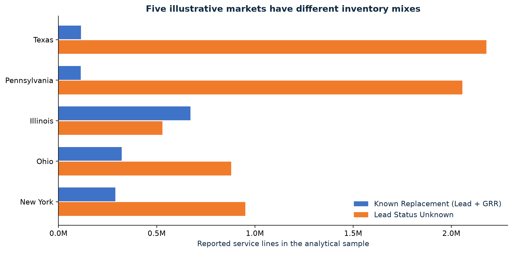

# Lead Service Line Analysis

### A proposed Xylem market approach based on EPA infrastructure inventories

**Python · pandas · Matplotlib · Jupyter · Data quality · Business communication**

Where are lead service line infrastructure needs greatest across U.S. states, and how could Xylem use those differences to guide its services?

I analyzed **43,993 Community Water Systems across 50 states and DC**, separating unresolved material identification from known replacement inventory. The resulting portfolio recommendation is to tailor proposed identification and replacement-planning services to the inventory mix, then assess individual utilities before selecting pilots.

**[Read the one-page summary](REMASTER/deliverables/Executive_Summary.pdf)** · **[View the five-slide story](REMASTER/deliverables/Xylem_Market_Recommendation.pdf)** · **[Explore the notebook](REMASTER/Lead_Service_Line_Analysis.ipynb)**



*Orange shows Lead Status Unknown. Blue shows known replacement inventory, defined as Lead plus Galvanized Requiring Replacement (GRR). Unknown does not mean lead. These five states illustrate contrasting inventories; they are not an exhaustive market shortlist.*

## Findings and proposed business action

| Finding within the analytical sample | Implication for further investigation |
|---|---|
| **21.59 million Unknown lines** compared with **3.12 million known replacement lines**, a 6.9-to-1 ratio | Identification and inventory completion deserve explicit attention alongside replacement planning |
| Texas and Pennsylvania have the largest Unknown inventories; Illinois has the largest known replacement inventory | Investigate identification emphasis in Texas/Pennsylvania and replacement-planning emphasis in Illinois |
| Ohio and New York have substantial inventories on both measures | Investigate parallel identification and replacement-planning work |
| Only 6 of the raw replacement top 10 and 3 of the raw Unknown top 10 remain after population adjustment | Absolute workload and inventory relative to state size offer different screening perspectives |
| New Hampshire contributes only 3 of 706 listed Community Water Systems to the complete-report sample | Low reported totals cannot automatically establish low infrastructure need |

The recommendation is a proposal, not a completed pilot or a claim of revenue, cost savings, or operational impact. Xylem's published capabilities provide context for the service fit. Utility records, GIS, funding, access and delivery capacity would determine whether a pilot is feasible.

## Analytical approach

1. Load the preserved **EPA 2026 Q2** inventory and inspect reporting status, missing values and count fields.
2. Retain complete-report Community Water Systems under state/DC primacy agencies. Convert text counts to numbers while preserving missing values.
3. Validate unique system IDs and reconcile service-line categories against reported totals.
4. Calculate **Known Replacement = Lead + GRR** and **Identification Need = Unknown**, retaining separate measures rather than a composite score.
5. Compare state inventories in absolute terms and per 10,000 residents using **2025 Census population**.
6. Examine reporting coverage, then connect the observed patterns to a qualified recommendation and a utility-screening process.

The notebook executed all **41 code cells without errors**. Verification reconciles the shared tables, source-file fingerprints, both editable presentation charts, the recommendation table, and the final document page counts. A GitHub Actions workflow reruns the notebook and package checks on relevant changes.

## Project context and contribution

**Author:** Darsh Rathi. **Context:** Xylem / IBM SkillsBuild data analytics micro-internship, followed by a portfolio remaster.

My analytical choices included separating identification from replacement, using resident population instead of summed utility service populations, keeping reporting exclusions visible, and qualifying the business recommendation at utility level. AI assisted with code, writing, visual production and automated verification. The [AI collaboration brief](REMASTER/deliverables/AI_Collaboration_Brief.pdf) distinguishes the original manual review from remaster automation and documents suggestions that needed correction.

## Deliverables

| Artifact | Read or inspect | Editable version |
|---|---|---|
| Executive summary | [One-page PDF](REMASTER/deliverables/Executive_Summary.pdf) | [Word](REMASTER/deliverables/Executive_Summary.docx) |
| Data story | [Five-slide PDF](REMASTER/deliverables/Xylem_Market_Recommendation.pdf) | [PowerPoint](REMASTER/deliverables/Xylem_Market_Recommendation.pptx) |
| Analysis | [Executed notebook](REMASTER/Lead_Service_Line_Analysis.ipynb) | Same notebook |
| AI collaboration | [Two-page PDF](REMASTER/deliverables/AI_Collaboration_Brief.pdf) | [Word](REMASTER/deliverables/AI_Collaboration_Brief.docx) |
| Supporting evidence | [State results](REMASTER/results/state_service_line_summary.csv), [reporting coverage](REMASTER/results/reporting_coverage.csv), [source register](REMASTER/SOURCES.md) | CSV and Markdown |

## Reproduce the analysis

Use **Python 3.12**. From the repository root:

```sh
python -m venv .venv
source .venv/bin/activate
python -m pip install -r REMASTER/requirements.txt
python REMASTER/production/execute_notebook.py
python REMASTER/production/verify_package.py
```

On Windows, activate with `.venv\Scripts\activate`. After installing dependencies, the analysis uses the packaged CSVs and runs without fetching new data. Executing the notebook refreshes its outputs and the shared result tables. See the [package guide](REMASTER/README.md) for details.

## Interpretation limits

- Unknown lines may ultimately be classified as non-lead. These inventories do not measure household exposure or drinking-water quality.
- Complete-report coverage counts systems, not service lines, and does not establish representativeness. State totals use Primacy Agency and exclude non-state/direct EPA-region records.
- Population-adjusted values provide size context, not estimates of affected residents or customers.
- State inventories do not establish utility readiness, customer demand, funding eligibility or project cost. No commercial outcome is claimed.

The [source register](REMASTER/SOURCES.md) connects findings to evidence and distinguishes calculated results from interpretation and proposals. The original submitted work and historical drafts remain recoverable in the [pre-remaster snapshot](https://github.com/drat-git/xylem-lead-service-line-analysis/tree/bbd4018c8b314eb4d4764529c1a56e24de63c680).
